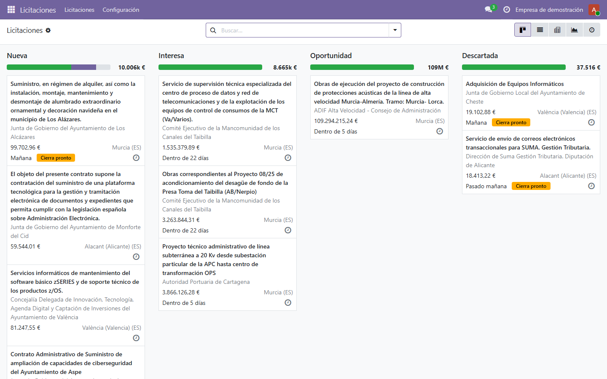
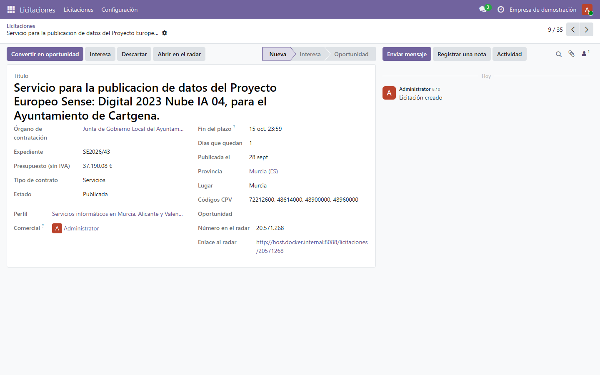
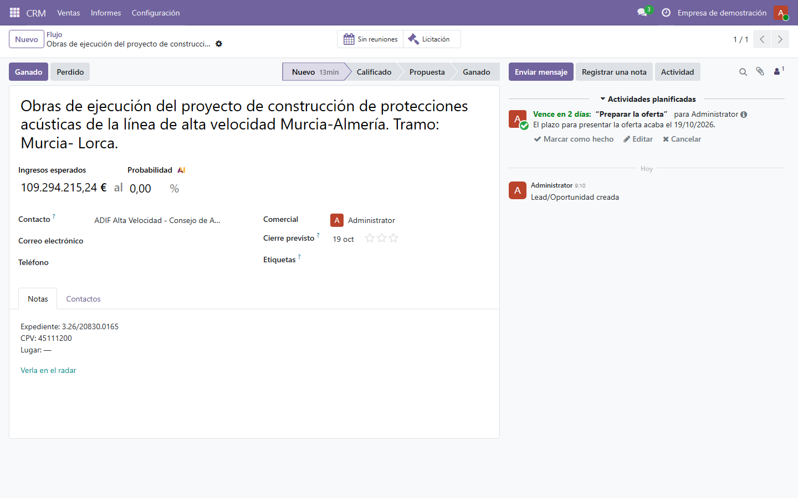
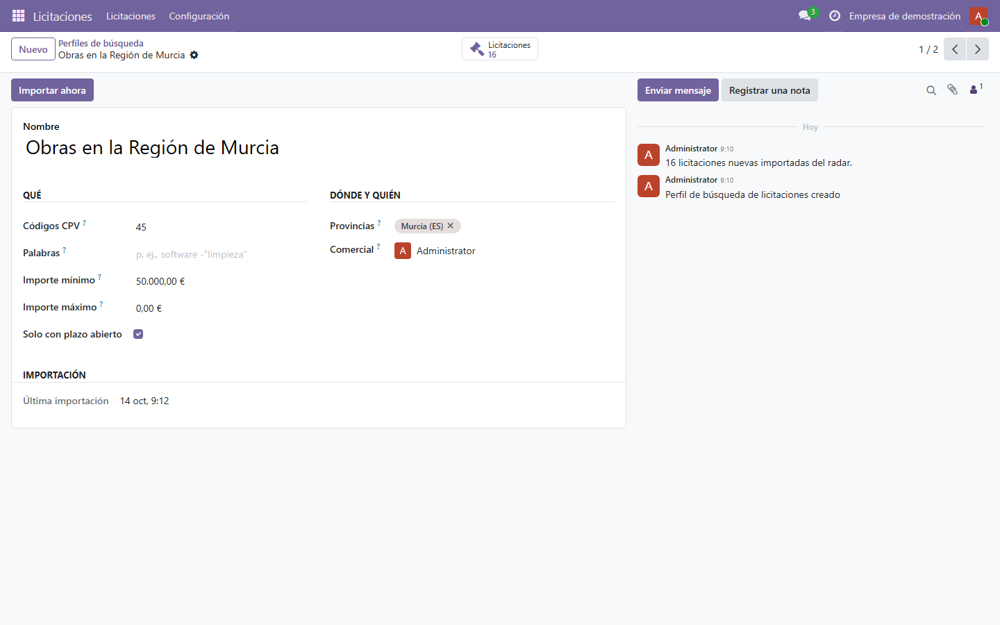
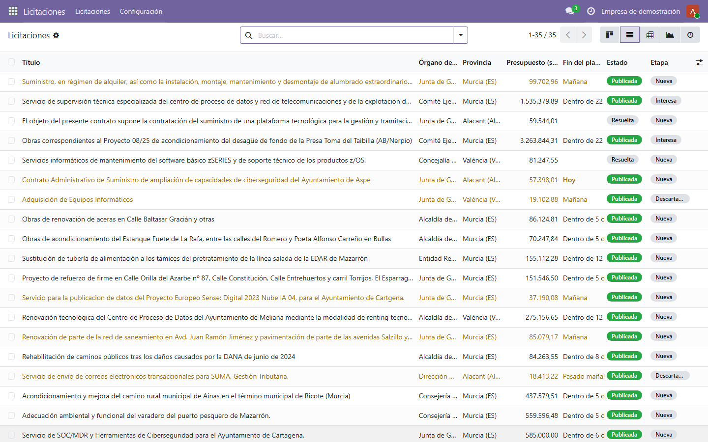
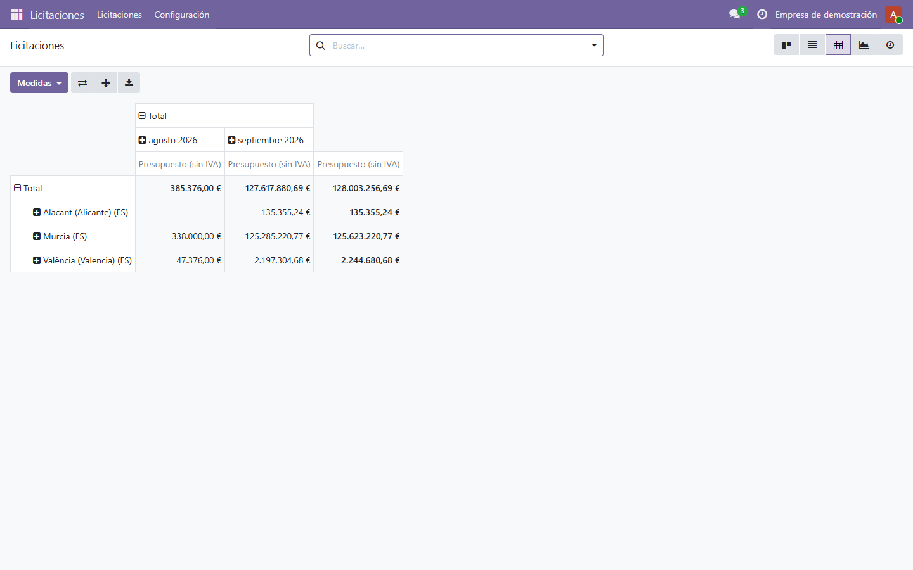

# Licitaciones en Odoo

Módulo de **Odoo 19** (`radar_licitaciones`) para una empresa que se presenta a concursos públicos: cada día importa
del [radar de licitaciones](https://github.com/marnau74/radar-licitaciones) las licitaciones que encajan con sus
perfiles de búsqueda (CPV, provincias, importes, palabras) y, con un botón, convierte la que interesa en una
**oportunidad del CRM** con el órgano de contratación como cliente y una tarea para el comercial antes de que cierre
el plazo.

**Odoo 19 Community · Python · ORM, herencia de modelos y vistas · acciones programadas · seguridad por grupos y
reglas multiempresa · informe QWeb · tests (TransactionCase y HttpCase con recorrido) · traducción al español ·
herramientas de la OCA**

| Kanban por etapa | Ficha de la licitación |
|---|---|
|  |  |

| Oportunidad creada | Perfil de búsqueda |
|---|---|
|  |  |

| Lista | Tabla dinámica |
|---|---|
|  |  |

Las licitaciones de las capturas son reales: las publicó la Plataforma de Contratación del Sector Público y las trae
el radar. La empresa, las etapas y la oportunidad convertida son de ejemplo (`scripts/demo.py`).

## Qué hace

- **Perfiles de búsqueda** con su comercial: CPV (o prefijos), provincias de Odoo, importe mínimo y máximo, palabras
  con la sintaxis del radar («frases» y -exclusiones) y solo las que tienen el plazo abierto.
- **Importación diaria** sin duplicados: una restricción única por licitación y compañía, creación por lotes,
  actualización solo de lo que ha cambiado (queda en el historial) y los órganos de contratación creados una sola
  vez como contactos.
- **Kanban por etapa** (*Nueva → Interesa → Oportunidad / Descartada*), lista con «cierra pronto» resaltado, filtros
  y agrupaciones, gráfico y tabla dinámica (importe por provincia y mes).
- **Convertir en oportunidad**: pide al radar la ficha del órgano (NIF, ciudad, web) y lo usa como cliente; si ya
  había un contacto con ese NIF, la oportunidad es suya y las demás licitaciones del órgano pasan a él. Programa una
  tarea tres días antes del fin del plazo y lo anota en el historial de la licitación.
- **Informe PDF** de la licitación.
- **Seguridad**: grupos *Usuario* (trabaja las licitaciones) y *Responsable* (configura e importa) y reglas por
  compañía.

## Cómo está hecho

```
radar_licitaciones/
├── models/
│   ├── radar_cliente.py      Cliente HTTP de la API del radar: tiempo de espera, reintentos de los fallos de red y 5xx
│   ├── radar_perfil.py       Perfil, parámetros de la búsqueda, importación y acción programada
│   ├── radar_licitacion.py   Licitación: sincronización por lotes, plazo, etapas y conversión en oportunidad
│   ├── res_partner.py        Órganos de contratación como contactos (por id del radar y por NIF)
│   ├── crm_lead.py           Enlace de la oportunidad con su licitación
│   └── provincias.py         Regiones NUTS 3 del radar ↔ provincias de Odoo
├── views/                    Kanban, lista, formulario, búsqueda, gráfico, tabla dinámica, ajustes y menús
├── security/                 Grupos, permisos y reglas multiempresa
├── report/                   Informe QWeb
├── data/                     Acción programada
├── i18n/                     Plantilla y traducción al español
├── static/tests/tours/       Recorrido de la interfaz para HttpCase
└── tests/                    Pruebas con respuestas reales grabadas del radar (tests/datos)
```

Decisiones que vale la pena contar:

- **El plazo se guarda en UTC y se convierte al mostrarlo**: el radar da `2026-10-20T21:59:00Z`, que en Madrid es el
  20 a las 23:59. El cierre previsto de la oportunidad y el vencimiento de la tarea se calculan con la zona horaria
  del usuario: un plazo a las 00:30 del 21 en Madrid es el 20 a las 22:30 en UTC, y con la fecha UTC la oportunidad
  cerraría un día antes.
- **«Días que quedan» y «Cierra pronto» no se guardan**: dependen de la hora actual y guardados se quedarían viejos al
  día siguiente. «Cierra pronto» se puede buscar igualmente porque tiene su método de búsqueda.
- **La red, fuera de lo que se prueba**: todo el acceso al radar pasa por un modelo con tiempo de espera y
  reintentos; en las pruebas se sustituye la llamada HTTP por respuestas reales grabadas. Un perfil que falla no para
  a los demás: la acción programada guarda el error en el perfil y la ficha lo enseña.
- Más en [docs/decisiones](docs/decisiones).

## Puesta en marcha

Hace falta Docker y, para importar, el [radar](https://github.com/marnau74/radar-licitaciones) en marcha (su compose
lo deja en el puerto 8088 del equipo, que desde el contenedor de Odoo es `host.docker.internal:8088`).

```bash
docker compose up -d
docker compose run --rm odoo odoo -d demo -i radar_licitaciones --load-language=es_ES --stop-after-init
docker compose run --rm -T odoo odoo shell -d demo --no-http < scripts/demo.py
```

Después, <http://localhost:8069> (usuario `admin`, contraseña `admin`, solo en local). `scripts/demo.py` configura la
dirección del radar, crea dos perfiles de búsqueda e importa.

## Pruebas

```bash
docker compose run --rm pruebas odoo -d pruebas -i radar_licitaciones --test-enable --test-tags /radar_licitaciones --stop-after-init
```

34 pruebas: importación con la respuesta real grabada, sin duplicados al repetir, cambios que se actualizan y quedan
en el historial, paginación, fallos de red y del servidor (reintentos, error guardado, acción programada que no
falla), parámetros de la búsqueda, validaciones, plazo con zonas horarias, conversión en oportunidad (cliente creado
o reutilizado por NIF, tarea programada), informe, permisos por grupo, aislamiento entre compañías y un recorrido de
la interfaz en Chrome (del kanban a la oportunidad y vuelta). El servicio `pruebas` es Odoo 19 con Chrome, que la
imagen oficial no trae.

Estilo y reglas de Odoo con las herramientas de la OCA: `pre-commit run --all-files` (ruff, pylint-odoo,
oca-checks-odoo-module, oca-checks-po y prettier para el XML). La CI (`.github/workflows/ci.yml`) pasa las dos cosas.

## Pasar a otra versión de Odoo

Lo que cambia de la 19 a otras versiones y está aislado en pocos sitios:

- **18**: los grupos usan `category_id` en lugar de `res.groups.privilege` y `groups_id` en lugar de `group_ids`;
  `models.Constraint` se escribe como `_sql_constraints`.
- **17**: además, `<tree>` en lugar de `<list>`, el historial con `<div class="oe_chatter">` en lugar de `<chatter/>` y
  la tarjeta del kanban como `kanban-box` en lugar de `card`.

## Licencia

LGPL-3, como Odoo Community.
